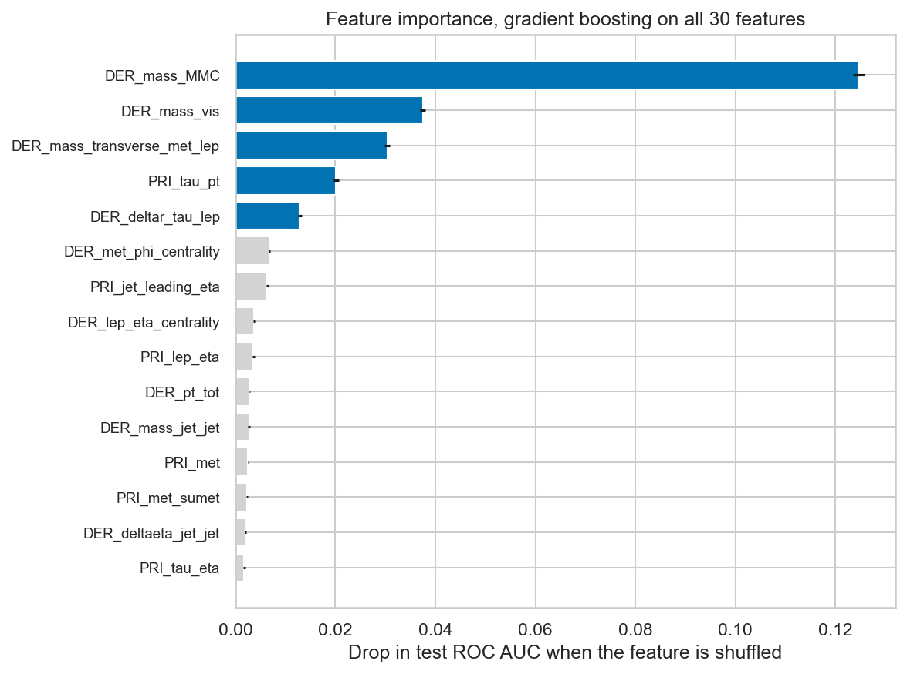
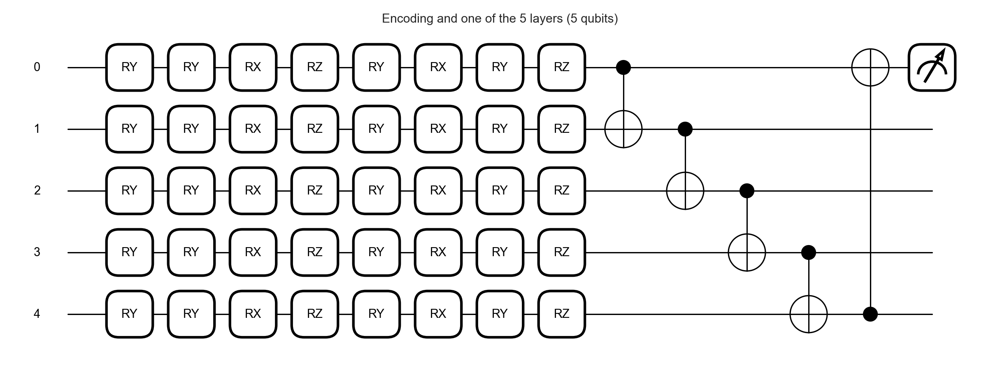
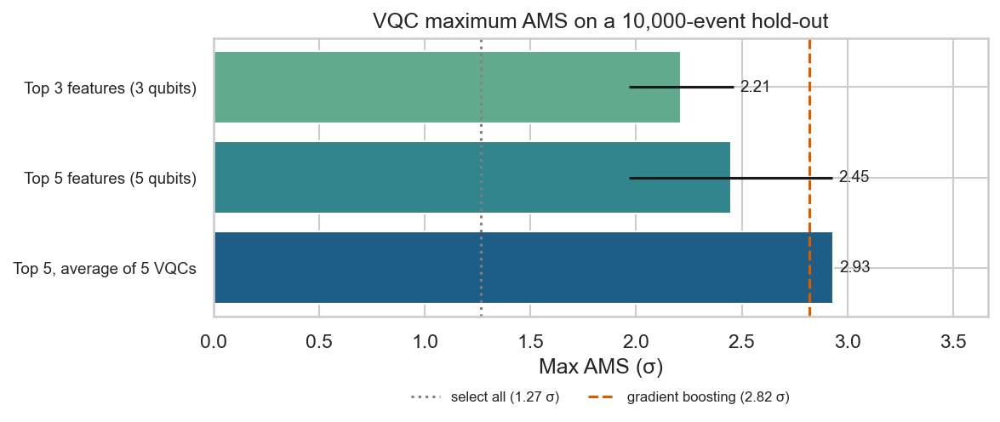

# Variational Quantum Classifier for the ATLAS Higgs Boson Challenge

A variational quantum classifier (VQC), built with PennyLane, that separates
Higgs → ττ signal events from background in the ATLAS Higgs Boson Machine
Learning Challenge (2014). It is scored on the challenge's own metric, the
Approximate Median Significance (AMS).

## 1. Choosing the features

A gradient boosting model is trained on all 30 features, and each feature is
ranked by how much the test ROC AUC drops when it is shuffled. The events of
the VQC hold-out are kept out of the ranking. The five most important features
go into the VQC, most important on qubit 0.



## 2. The model



- **Encoding.** Each feature is mapped to [0, π] with a quantile transform and
  written onto its own qubit with an RY rotation, followed by a fixed RZ(π/2).
- **Layers.** Each of the five layers re-uploads the features with RY, applies
  trainable RX, RY and RZ rotations and entangles the qubits with a chain of
  CNOTs, closed into a ring by a CNOT from the last qubit back to qubit 0.
- **Read-out.** The expectation value ⟨Z₀⟩ is the decision score.

## 3. Results

AMS maximized over the decision threshold, on a hold-out of 10,000 weighted
events. Each VQC draws a random sample of 1,000 events, trains on 700 of them
and uses the other 300 to monitor training. Single-model values are the mean
over five seeds. Events with a missing value in any of the chosen features are
left out.



| Setup | Max AMS (σ) |
| --- | :---: |
| VQC, top 3 features | 2.21 ± 0.25 |
| VQC, top 5 features | 2.45 ± 0.48 |
| VQC, top 5 features, average of 5 models | **2.93** |
| Gradient boosting, top 5 features, same data | 2.82 ± 0.13 |

## Installation and use

```bash
git clone https://github.com/gabriel-a-pedrosa/higgs-vqc.git
cd higgs-vqc
pip install -r requirements.txt
python scripts/download_data.py      # about 195 MB, from CERN Open Data
python scripts/run_experiments.py    # ranking, VQC runs and figures
```

## References

1. C. Adam-Bourdarios et al. *The Higgs boson machine learning challenge.*
   NIPS 2014 Workshop, CERN Open Data Portal,
   [record 328](https://opendata.cern.ch/record/328).
2. [PennyLane](https://pennylane.ai/).

## Authors

Gabriel A. Pedrosa and Pedro H. Magalhães, MSc in Engineering Physics (Physics
of Information), University of Minho. Released under the [MIT License](LICENSE).
